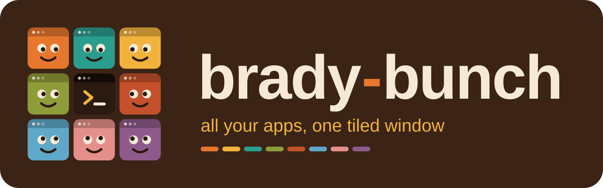

# brady-bunch



Run your whole dev stack in one window. brady-bunch starts a list of Windows programs (servers, watchers, consoles, GUI tools), tiles their windows in a grid inside one host window, and stops them all cleanly when you close it.

- **One window, every app.** Console and GUI apps are embedded side by side. Click a tile to type into it; double-click its header to zoom it.
- **Starts things in order.** An app can wait until another is listening on a port, answering HTTP, or has printed a line in its output.
- **Builds first.** Setup tasks such as `dotnet build` or `npm ci` run before any app starts, and a failed build stays on screen.
- **Shuts down gracefully.** Closing the window sends each app Ctrl+C (or a close message), in reverse dependency order, and only kills what's left after a timeout. Even if the host crashes, Windows cleans up every child process.
- **Scriptable.** `brady-ctl up` starts the stack and returns once it's ready; `brady-ctl down` stops it.

📖 **Full documentation is in the [wiki](https://github.com/ryancole/brady-bunch/wiki).**

## Install

In PowerShell:

```powershell
irm https://github.com/ryancole/brady-bunch/releases/latest/download/install.ps1 | iex
```

This installs brady-bunch into `%LOCALAPPDATA%\Programs\brady-bunch` and adds it to your PATH. Run it again to update.

Or download the zip from [Releases](https://github.com/ryancole/brady-bunch/releases) and extract it anywhere, keeping its three exes together. See [Installation](https://github.com/ryancole/brady-bunch/wiki/Installation) for options such as pinning a version.

## Quick start

Create a `brady.toml` in your project folder:

```toml
title = "my stack"

[[task]]
name = "build"
command = 'dotnet build src\App.sln -nodeReuse:false'

[[app]]
name = "db"
command = 'C:\tools\db\db.exe --port 5432'
ready = { tcp = 5432 }

[[app]]
name = "api"
command = 'dotnet run --no-build --project src\Api'
depends_on = ["db"]
ready = { http = "https://localhost:8002/health" }
exit_with = "main"
url = "https://localhost:8002"

[[app]]
name = "web"
command = 'cmd /c npm start'
cwd = 'web'
```

Check it, then start it:

```powershell
brady-ctl check
brady-bunch
```

The build runs first, then `db` and `web` start, and `api` waits until the database accepts connections. Close the window to stop everything.

[Getting Started](https://github.com/ryancole/brady-bunch/wiki/Getting-Started) walks through this step by step, and [brady.example.toml](brady.example.toml) lists every setting.

## Command line

```
brady-bunch [config.toml] [--profile name] [--only app,app] [--skip app,app]
```

The config defaults to `brady.toml` in the current folder. `--only` and `--skip` run part of a config; `--profile` uses a named selection from it.

`brady-ctl` controls a running stack from a shell or script:

| Command | Does |
|---|---|
| `brady-ctl check` | Validate the config without starting anything. |
| `brady-ctl up` | Start the stack and wait until everything is ready. |
| `brady-ctl down` | Stop it gracefully and wait until it has exited. |
| `brady-ctl status` | Every app's state, as JSON. |
| `brady-ctl restart api` | Restart one app. Also `start`, `stop` and `wait`. |
| `brady-ctl run build` | Rerun a task, stopping the apps that lock its output first. |
| `brady-ctl tail api` | Print an app's recent console output. |

See [brady-ctl](https://github.com/ryancole/brady-bunch/wiki/brady-ctl) for every option and exit code.

## Learn more

- [Configuration](https://github.com/ryancole/brady-bunch/wiki/Configuration): every setting
- [Startup Order and Readiness](https://github.com/ryancole/brady-bunch/wiki/Startup-Order-and-Readiness): `depends_on`, `ready`, health checks, apps already running elsewhere
- [Tasks and Rebuilds](https://github.com/ryancole/brady-bunch/wiki/Tasks-and-Rebuilds): builds before startup, and rebuilding while running
- [Profiles and Selections](https://github.com/ryancole/brady-bunch/wiki/Profiles-and-Selections): one config, several ways to run it
- [Recipes](https://github.com/ryancole/brady-bunch/wiki/Recipes): .NET, Node, Java, Python and more
- [Troubleshooting](https://github.com/ryancole/brady-bunch/wiki/Troubleshooting)
- [AGENTS.md](docs/AGENTS.md): a complete reference written for AI coding agents that drive brady-bunch

## Limitations

- Store/UWP apps (the new Notepad, Calculator, Windows Terminal) run but can't be embedded.
- Elevated apps can't be embedded by a host that isn't elevated.
- A GUI app's window can show on the desktop for a moment before it's embedded. Console apps don't.
- Force-killing the host (`taskkill /f`) skips graceful shutdown, though every child is still killed.
- With `log` (or `ready = { log = ... }`), an app's output goes through a pipe, so some programs drop colours and progress bars, or buffer their output.

## Contributing

See [CONTRIBUTING.md](CONTRIBUTING.md) for building, testing and releasing.
